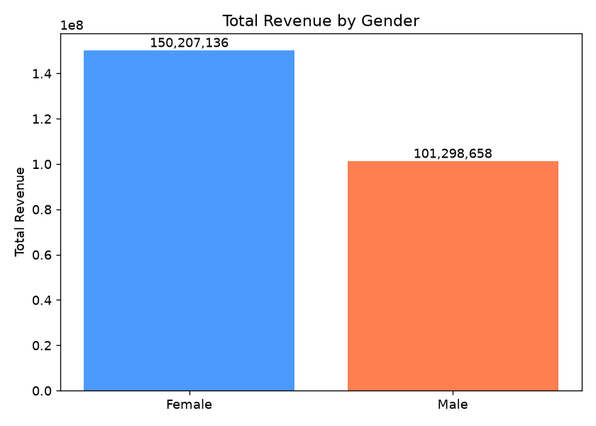
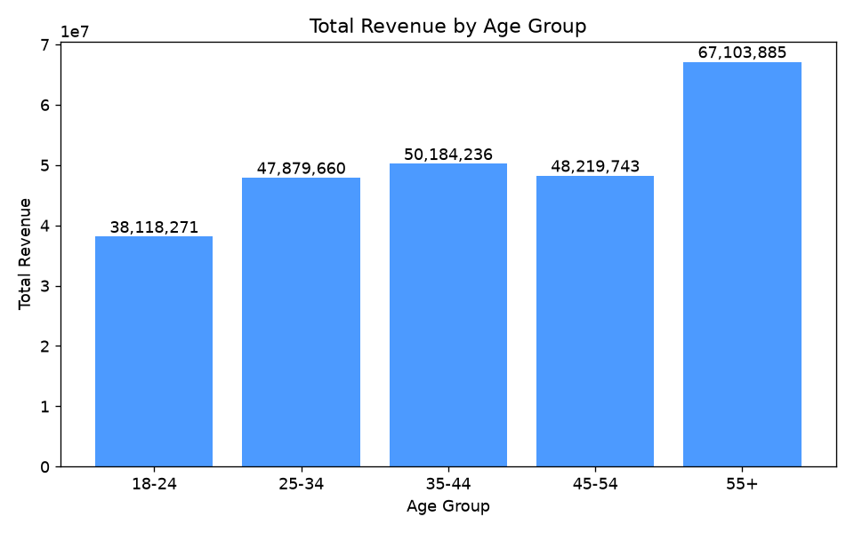
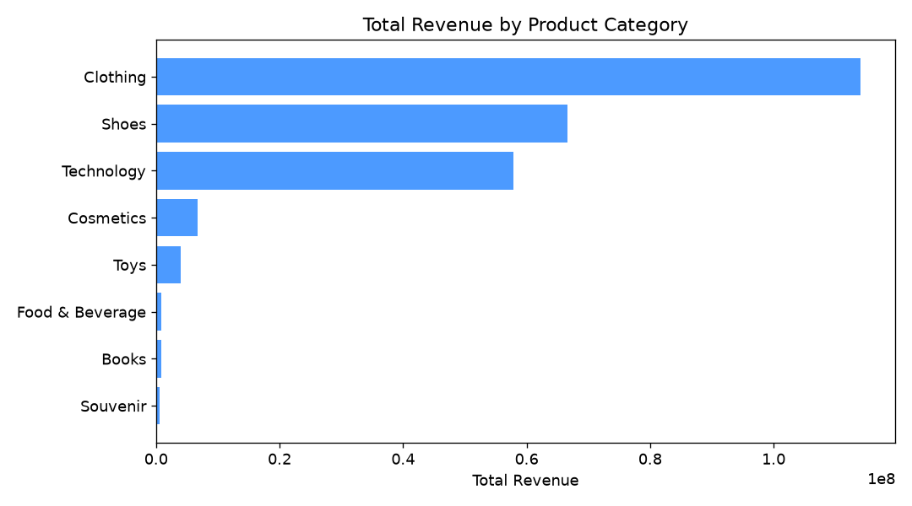
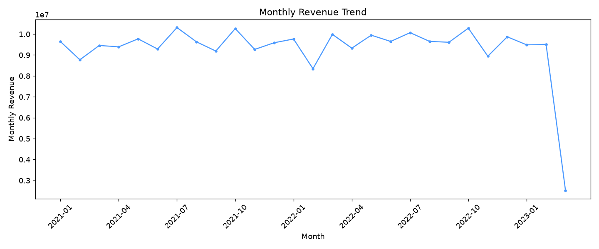
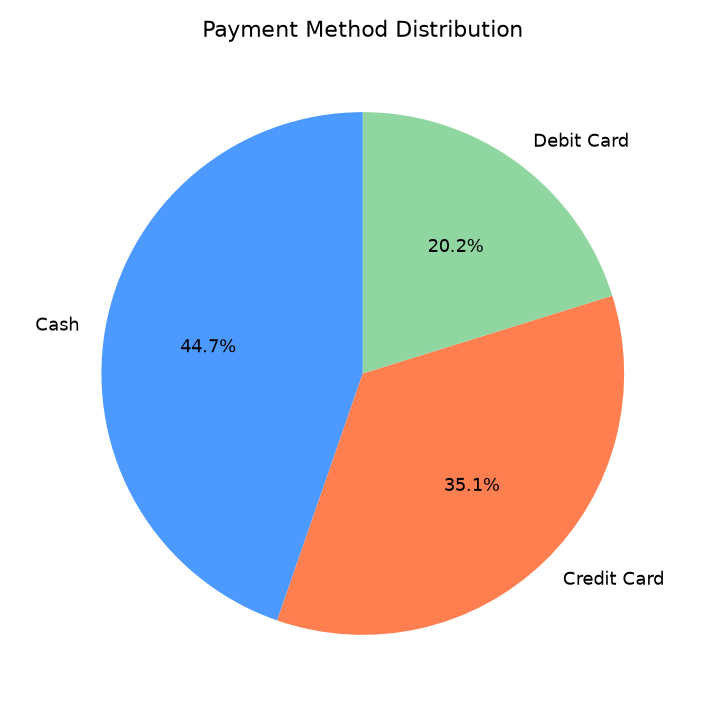
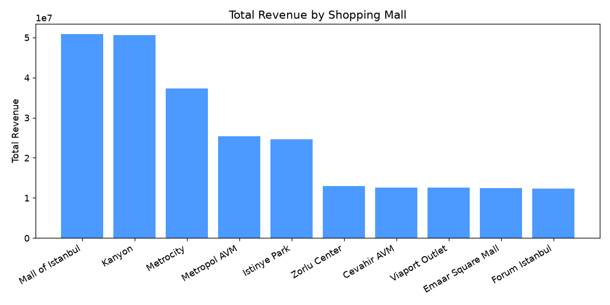
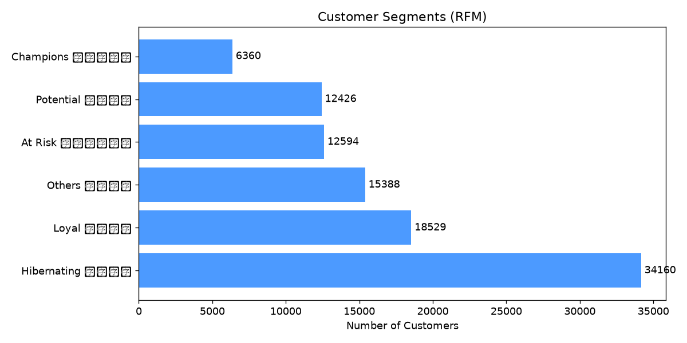
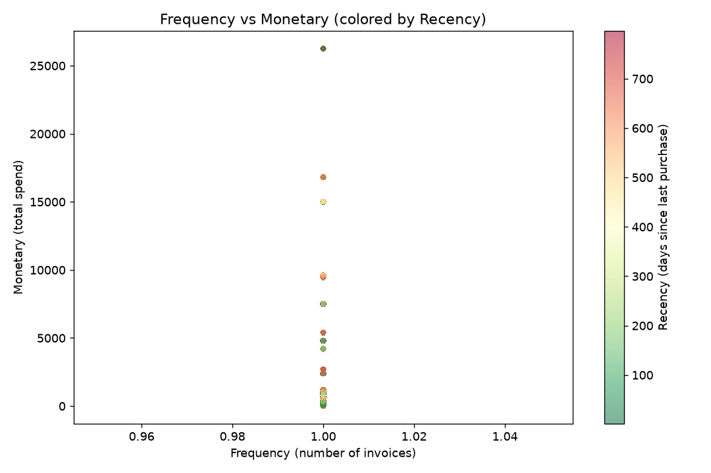

# Customer Shopping Data Analysis（客户消费行为数据分析）

一个面向数据分析入门的完整实战项目：从原始数据出发，完成 **数据清洗 → 探索性数据分析（EDA）→ 可视化 → RFM 客户分群** 的全流程，并产出商业结论。

- 数据规模：99,457 条购物记录、10 个字段、9,945 位客户
- 技术栈：Python / pandas / matplotlib
- 代码含详细中文注释，零基础可跟学

---

## 一、数据来源

本数据集来自 Kaggle 公开数据集：

- **名称**：Customer Shopping Dataset - Retail Sales Data
- **作者**：Mehmet Tahir Aslan
- **链接**：https://www.kaggle.com/datasets/mehmettahiraslan/customer-shopping-dataset
- **背景**：数据来自土耳其伊斯坦布尔的 10 家购物中心，记录了 2021 年至 2023 年间的真实客户消费行为（数据已脱敏）。
- **声明**：本数据仅用于学习与研究目的，版权归原作者所有。

## 二、数据集字段说明

| 字段名 | 含义 | 类型 |
| --- | --- | --- |
| invoice_no | 发票编号（一条记录对应一次购买的某个商品行） | 文本 |
| customer_id | 客户编号 | 文本 |
| gender | 性别（Male / Female） | 文本 |
| age | 年龄（18–69） | 整数 |
| category | 商品类别（共 8 类：服装、鞋、科技产品、化妆品等） | 文本 |
| quantity | 购买数量（1–5） | 整数 |
| price | 单价（土耳其里拉） | 小数 |
| payment_method | 支付方式（现金 / 信用卡 / 借记卡） | 文本 |
| invoice_date | 消费日期 | 文本（需转换为日期） |
| shopping_mall | 商场名称（共 10 家） | 文本 |

## 三、项目结构

```
customer-shopping-analysis/
├── README.md                        # 项目说明（本文件）
├── requirements.txt                 # Python 依赖清单
├── data/
│   ├── customer_shopping_data.csv   # 原始数据（来自 Kaggle）
│   └── customer_shopping_cleaned.csv# 清洗后数据（由脚本 02 生成）
├── src/                             # 分析代码（按顺序运行）
│   ├── 01_data_overview.py          # 第一步：数据初探
│   ├── 02_data_cleaning.py          # 第二步：数据清洗
│   ├── 03_eda_visualization.py      # 第三步：EDA 可视化
│   └── 04_rfm_analysis.py           # 第四步：RFM 客户分群
└── outputs/                         # 分析产物（图表 + RFM 明细）
    ├── 01_gender_revenue.png
    ├── 02_age_group_revenue.png
    ├── 03_category_revenue.png
    ├── 04_monthly_trend.png
    ├── 05_payment_method.png
    ├── 06_mall_revenue.png
    ├── 07_rfm_segment.png
    ├── 08_rfm_scatter.png
    └── rfm_results.csv              # 每位客户的 RFM 得分与分层
```

## 四、如何运行（零基础教程）

1. 安装 Python 3.10 及以上版本（官网 https://www.python.org 下载即可）。
2. 下载本项目到本地，打开终端进入项目根目录。
3. 安装依赖：

```bash
pip install -r requirements.txt
```

4. 按顺序运行 4 个脚本：

```bash
python src/01_data_overview.py
python src/02_data_cleaning.py
python src/03_eda_visualization.py
python src/04_rfm_analysis.py
```

5. 运行完毕后，图表和结果文件都在 `outputs/` 文件夹中。

## 五、分析结论（核心发现）

### 1. 性别与消费



女性客户贡献了约 **59.7%** 的销售额，是消费的绝对主力。

### 2. 年龄段消费力



**55+ 年龄段**客单价与总额最高，是中高端商品的核心客群；年轻客群（18-24）消费力相对有限。

### 3. 商品类别排行



**服装（Clothing）** 一骑绝尘，贡献了最大的销售额；其次是鞋类（Shoes）和科技产品（Technology）。

### 4. 月度销售趋势



销售额整体平稳，没有明显的淡旺季；最后一个点（2023-03）骤降是因为数据只收录到 2023 年 3 月 8 日，属于不完整月份，并非业务下滑。

### 5. 支付方式偏好



**现金支付占 44.7%**，信用卡约 35%，借记卡约 20%——本地客户仍偏爱现金。

### 6. 商场销售排行



**Mall of Istanbul** 和 **Kanyon** 是销售额最高的两家商场。

### 7. RFM 客户分群

RFM 模型从三个维度给客户打分：

- **R**ecency：最近一次消费距今多少天（越小越好）
- **F**requency：消费次数（越多越好）
- **M**onetary：消费总额（越多越好）



| 分层 | 人数占比 | 销售额占比 | 运营建议 |
| --- | --- | --- | --- |
| Champions 高价值客户 | 6.4% | 12.3% | 重点维护，VIP 权益、专属服务 |
| Loyal 忠实客户 | 18.6% | 12.8% | 会员体系沉淀，交叉推荐 |
| Potential 潜力客户 | 12.5% | 12.4% | 优惠券刺激复购，提升频次 |
| At Risk 流失预警客户 | 12.7% | 24.0% | **曾经的优质客户，优先挽回** |
| Hibernating 沉睡客户 | 34.3% | 20.9% | 低成本唤醒（邮件/短信推送） |



散点图中每个点是一位客户，颜色越红表示越久没来消费。可以看到：**高消费客户中有相当一部分已经很久没来（At Risk）**，他们贡献了 24% 的销售额，是最值得挽回的人群。

## 六、本项目用到的知识点

- pandas：数据读取、分组聚合（groupby）、透视、分位数切分（qcut）、日期处理
- 数据清洗：去重、缺失值检查、类型转换、衍生列构造
- matplotlib：柱状图、横向条形图、折线图、饼图、散点图
- 分析方法论：EDA 探索性数据分析、RFM 客户价值模型

## 七、后续可扩展方向

- 用 seaborn / plotly 做更精美的交互式图表
- 用 K-Means 聚类对客户做无监督分群，与 RFM 结果对比
- 按商场 × 类别做交叉透视分析，为商场招商提供建议
- 用 Jupyter Notebook 重写分析过程，便于交互展示

## 八、许可证

代码部分采用 MIT License，可自由使用；数据部分版权归原作者所有，仅限学习使用。
